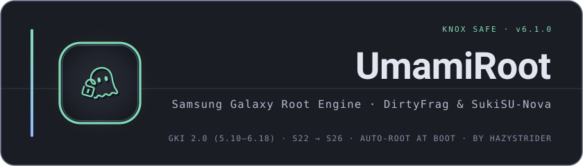

# UmamiRoot

<div align="center">



<br/>

-253D6E?style=flat&labelColor=1B1D24)


[](https://github.com/Hazystrider/UmamiRoot/releases/latest)
[](https://github.com/Hazystrider/UmamiRoot/commits)
[](https://github.com/Hazystrider/UmamiRoot/commits)
[](https://github.com/Hazystrider/UmamiRoot/actions/workflows/debug-apk.yml)

<p><b>One-tap root for Samsung Galaxy devices — New exploit (DirtyFrag CVE-2026-43284, unprivileged) + Old exploit profiles, with auto-root at every boot.</b></p>

<p>Made by <b>Hazystrider</b> · <b>I am not responsible for bricked phones.</b></p>

</div>

---

## About

**UmamiRoot** (`v6.1.0`) is my fork of **UniRoot** for Samsung Galaxy devices, built around the Knox-safe DirtyFrag late-load engine with **KernelSU 3.4.0+** alignment and **SukiSU-Nova** Samsung KDP/RKP/DEFEX support wired in alongside KernelSU Classic and KernelSU-Next. See [CHANGELOG.md](./CHANGELOG.md) for version history.

---

## Supported Devices & Kernels (GKI 2.0)

DirtyFrag + late-load LKM root requires **GKI 2.0 (Linux 5.10 – 6.18)**:

| Samsung Galaxy Models | Kernel | KMI Targets | Status |
| :--- | :---: | :--- | :---: |
| **Galaxy S26 / Z Fold 8** | `6.12` / `6.18` | `android16-6.12`, `android17-6.18` | Supported |
| **Galaxy S25 / Z Fold 7 / Z Flip 7** | `6.6` | `android15-6.6` | Supported |
| **Galaxy S24 / Z Fold 6 / Z Flip 6** | `6.1` | `android14-6.1` | Supported |
| **Galaxy S23 / Z Fold 5 / Z Flip 5** | `5.15` | `android13-5.15`, `android14-5.15` | Supported |
| **Galaxy S22 / Z Fold 4 / Z Flip 4** | `5.10` | `android12-5.10`, `android13-5.10` | Supported |
| **Galaxy S21 / Z Fold 3 / Z Flip 3** | `5.4` | Non-GKI 2.0 | Not supported (identified) |
| **Galaxy Note 20 / S20 / Note 10 / S10** | `4.19` / `4.14` | Non-GKI 2.0 | Not supported (identified) |

---

## What's New in V6

- **New exploit (fast)** aligned to **KernelSU 3.4.0** with the help of **shedowe19**. Everything from V5 stays intact (in-app `ksud` updater, profile selector, auto-root at boot, live progress UI, and root state banner).
- **SukiSU-Nova first-class support** with its own flavor tab, bundled profile, and one-tap updater wired into the same flow as KernelSU and KernelSU-Next (pulls Samsung KDP/RKP/DEFEX builds from this repo's releases, with upstream fallback).
- **Rewired device identification** extended back out to the **Galaxy Note 20** (and S10/Note 10). The app now clearly tells you whether your device is eligible (GKI 2.0 `5.10+`) and which exploit method it works with.
- **Soft-reboot root state fix** so the app holds onto root status across soft reboots even when it doesn't have direct `su` permissions granted.

---

## Old Exploit (Slow)

The classic profile pipeline stays untouched: CVE-2026-43499 payloads (local or Shizuku), Root My Galaxy integration, per-device validated profiles (S25 ZZHL/ZZI4, S26 Ultra ZZHK, S93XX, Oppo), profile editor, instant root, and run-log archives.

---

## KernelSU & SukiSU-Nova Compatibility

This build includes Samsung KDP/DEFEX/RKP modules from **GhostSam v0.2.4** (KernelSU-Next **3.4.2 / 33355 / UAPI 5**, pinned in [`SOURCE.json`](./app/src/main/assets/df/samsung-ko/SOURCE.json)) alongside **SukiSU-Nova** Samsung KDP/RKP/DEFEX support.

- The Next updater checks that the release matches the bundled modules and compares saved profile bytes so older bundles under the same tag get replaced cleanly.
- Use a matching **3.4.x** manager (or the **SukiSU-Nova** manager when running SukiSU-Nova).
- After updating a profile, reboot and re-root to replace a kernel module that's already loaded in memory.

---

## Build & CI

```sh
./gradlew assembleRelease                  # -> app/build/outputs/apk/release/
./gradlew testDebugUnitTest assembleDebug  # -> unit tests + debug APK
```

Set `KSUD_TEST_FIXTURE` to the SHA-256-verified official `ksud` v3.4.2 binary to also run the real-binary regression test locally.

- **[Debug APK](.github/workflows/debug-apk.yml):** Runs all unit tests with the verified `ksud` fixture and uploads a downloadable debug APK + SHA-256 in the run summary (requires GitHub sign-in, retained 90 days; signed with a temporary debug key so it can't update an APK signed with another key).
- **[Build SukiSU-Nova Samsung KDP](.github/workflows/build-sukisu-nova-kdp.yml):** Applies [`patches/sukisu-nova-samsung-kdp-rkp-defex.patch`](./patches/sukisu-nova-samsung-kdp-rkp-defex.patch) and compiles `kernelsu.ko` + `ksud` across Android 12–17 KMI targets.

---

## Credits

This app stands on the shoulders of:

- **kuuky29** — [UniRoot](https://github.com/kuuky29/UniRoot): Upstream base, credited for the Knox-safe temporary DirtyFrag LKM loader and `ksud` bundling.
- **SukiSU-Nova** — Upstream kernel/LKM target (SukiSU-Ultra / SukiSU-Nova), credited for the late-load `kernelsu.ko` / `ksuinit` KDP module and SUSFS integration.
- **shedowe19** — KernelSU 3.4.0 alignment, regression test fixtures, and DirtyFrag PR work.
- **diabl0w** — [DFRoot](https://github.com/diabl0w/DFRoot): The DirtyFrag engine this whole project is built around.
- **snothin** — [GhostSam](https://github.com/snothin/GhostSam): The Samsung-patched `.ko`s, `ksud` patching approach, and staged native API.
- **polygraphene** — The DFRoot fork lineage and DEFEX bypass work.
- **tiann** — [KernelSU](https://github.com/tiann/KernelSU).
- **rifsxd & the KernelSU-Next team** — [KernelSU-Next](https://github.com/KernelSU-Next/KernelSU-Next).
- **YuKongA** — [GhostLock](https://github.com/YuKongA/GhostLock): The UI this app's interface is based on.

Thanks!

---

## Disclaimer & User Responsibility

UmamiRoot runs kernel-level exploits and loads kernel modules (`kernelsu.ko`) at runtime on Samsung Galaxy devices.

- **Use at your own risk.** I am **not responsible** for bricked phones, bootloops, data loss, tripped Knox/warranty flags, broken updates, or Play Integrity failures.
- Keep backups before messing with root or kernel modules.

## AI Assistance Disclosure

Portions of UmamiRoot's Kotlin/Java glue, SukiSU-Nova integration, UI theming, CI workflows, and documentation were drafted or refined with the help of AI coding tools, then reviewed and tested by me on-device. Because this app loads kernel modules and interacts with privileged root components, feel free to inspect the source and CI build scripts directly before installing.
